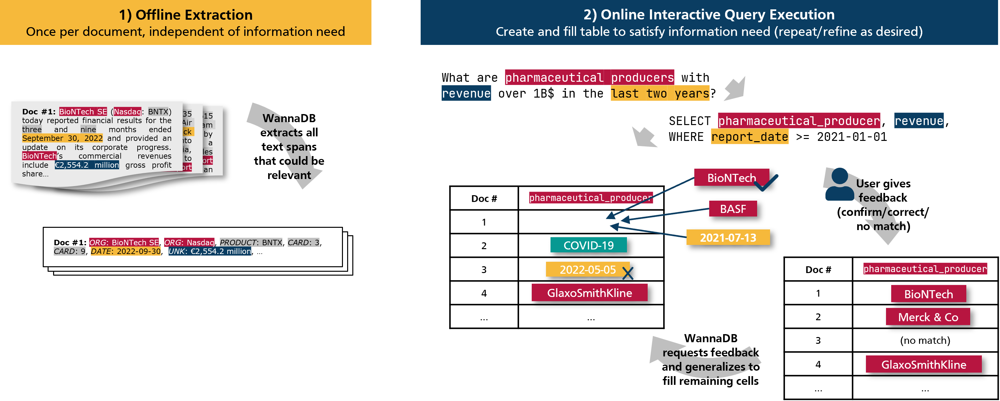
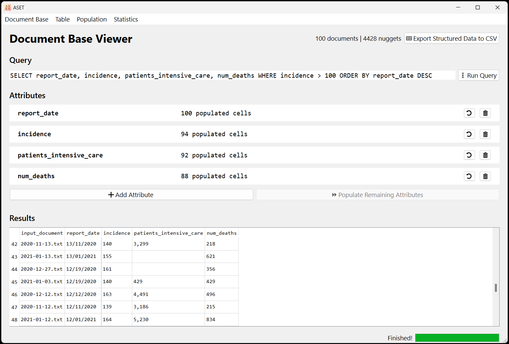
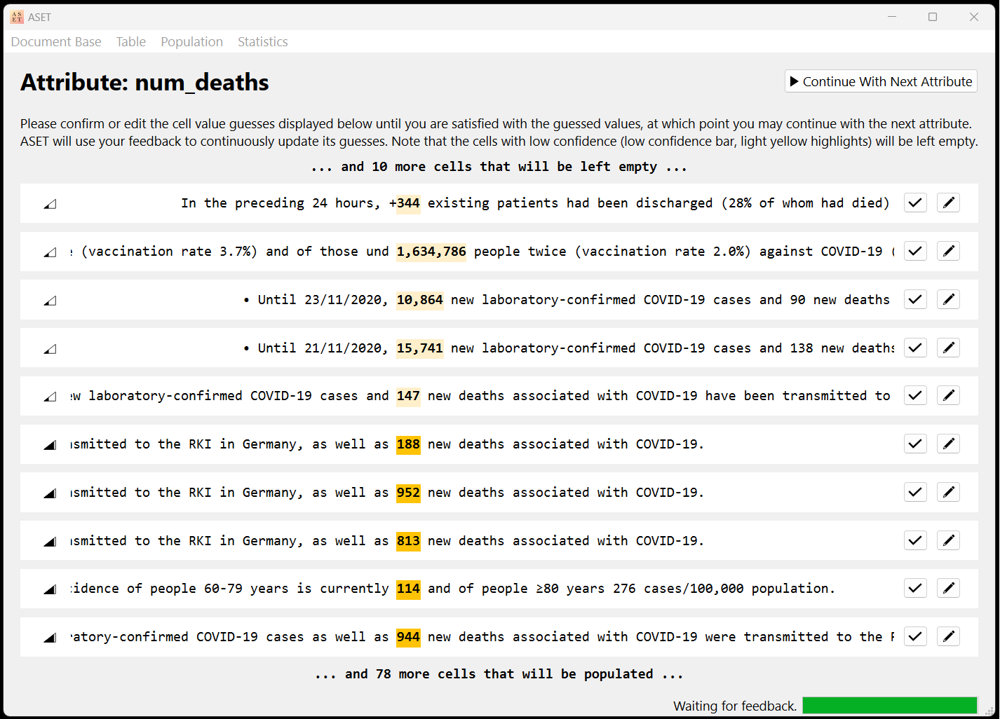
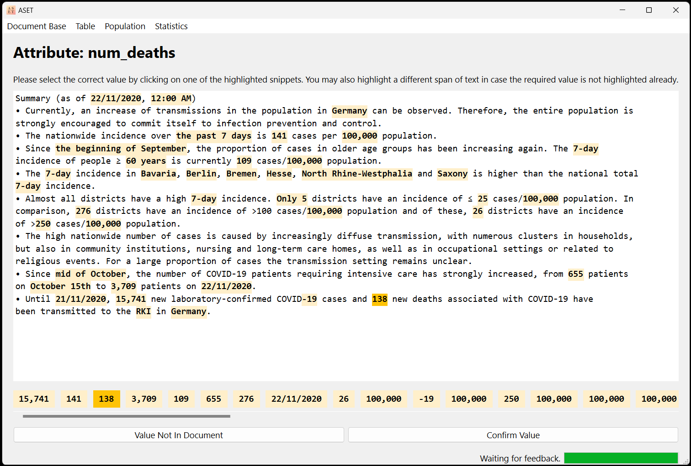
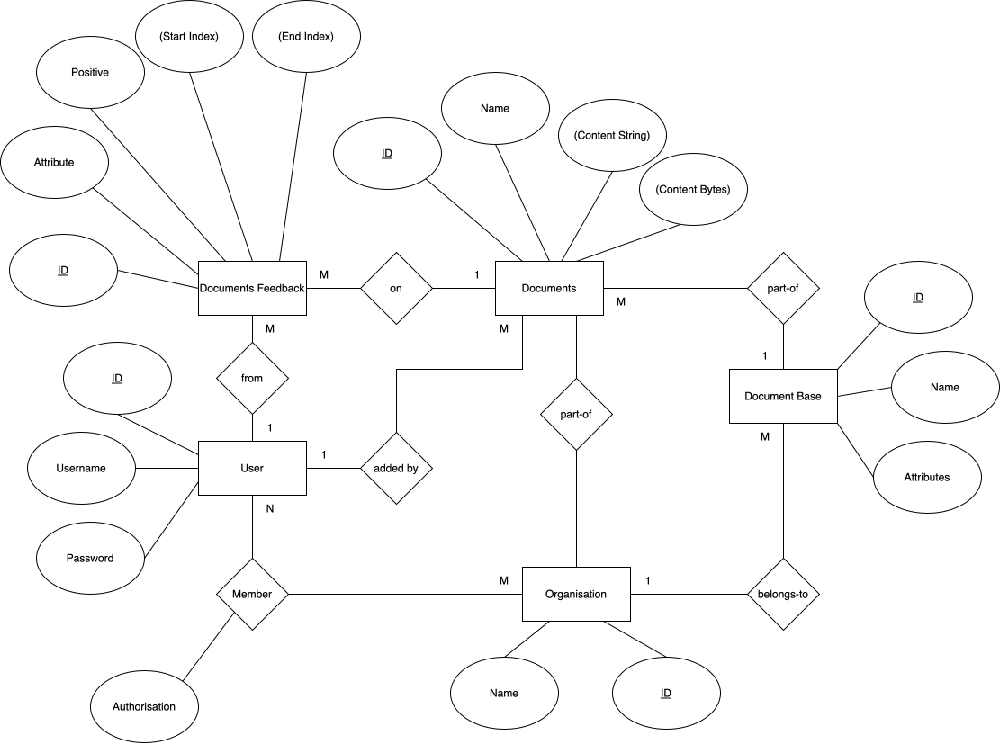

# WannaDB: Ad-hoc SQL Queries over Text Collections



WannaDB allows users to explore unstructured text collections by automatically organizing the relevant information nuggets in a table. It supports ad-hoc SQL queries over text collections using a novel two-phased approach: First, a superset of information nuggets is extracted from the texts using existing extractors such as named entity recognizers. The extractions are then interactively matched to a structured table definition as requested by the user.

Watch our [demo video](https://link.tuda.systems/aset-video) or [read our paper](https://doi.org/10.18420/BTW2023-08) to learn more about the usage and underlying concepts.

## GUI

Our tool is provided ready-to-use with a graphical user interface that allows to load own text collections and execute the table extraction on them.


*Main Window, specify the query or attributes list, check current table filling state and inspect the result table.*


*Interactive matching, inspect the current list of feedback requests and confirm matches or request detailed inspection.*


*Inspect a single document, see the extractions in context and chose the correct one (including custom text spans)  or state that the document does not contain a relevant value.*

## Usage

Run `main.py` to start the WannaDB GUI.

To run batch experiments instead, use `experiments/experiment_runner.py`.

To run the preprocessing stand-alone (e.g., on a server with GPUs) you can use `scripts/preprocess.py`.

See [EXTRACTORS.md](EXTRACTORS.md) for more information on the interactive extraction component.

## Installation

The steps below install the desktop and core components. The web deployment uses Python 3.11 and installs both dependency files in Docker.

##### 1. Create a virtual environment

```shell
python -m venv venv
source venv/bin/activate
export PYTHONPATH="."
```

##### 2. Install the dependencies

```shell
pip install --upgrade pip
pip install --use-pep517 -r core-requirements.txt
pip install --use-pep517 pytest
```

You may have to install `torch` by hand if you want to use CUDA:

<https://pytorch.org/get-started/locally/>

##### 3. Run the tests

```shell
pytest
```

## Citing WannaDB

The code in this repository is the result of several scientific publications. If you build upon WannaDB, please cite:

```bibtex
@inproceedings{wannadb@BTW23,
author = {Hättasch, Benjamin AND Bodensohn, Jan-Micha AND Vogel, Liane AND Urban, Matthias AND Binnig, Carsten},
title = {WannaDB: Ad-hoc SQL Queries over Text Collections},
booktitle = {BTW 2023},
year = {2023},
editor = {König-Ries, Birgitta AND Scherzinger, Stefanie AND Lehner, Wolfgang AND Vossen, Gottfried} ,
doi = { 10.18420/BTW2023-08 },
publisher = {Gesellschaft für Informatik e.V.},
address = {}
}
```

If you want to reference specific features/parts, our further publications might be relevant:

```bibtex
@inproceedings{aset@SIGMOD22,
author = {H\"{a}ttasch, Benjamin and Bodensohn, Jan-Micha and Binnig, Carsten},
title = {Demonstrating ASET: Ad-Hoc Structured Exploration of Text Collections},
year = {2022},
isbn = {9781450392495},
publisher = {Association for Computing Machinery},
address = {New York, NY, USA},
url = {https://doi.org/10.1145/3514221.3520174},
doi = {10.1145/3514221.3520174},
abstract = {In this demo, we present ASET, a novel tool to explore the contents of unstructured data (text) by automatically transforming relevant parts into tabular form. ASET works in an ad-hoc manner without the need to curate extraction pipelines for the (unseen) text collection or to annotate large amounts of training data. The main idea is to use a new two-phased approach that first extracts a superset of information nuggets from the texts using existing extractors such as named entity recognizers. In a second step, it leverages embeddings and a novel matching strategy to match the extractions to a structured table definition as requested by the user. This demo features the ASET system with a graphical user interface that allows people without machine learning or programming expertise to explore text collections efficiently. This can be done in a self-directed and flexible manner, and ASET provides an intuitive impression of the result quality.},
booktitle = {Proceedings of the 2022 International Conference on Management of Data},
pages = {2393–2396},
numpages = {4},
keywords = {matching embeddings, text to table, interactive text exploration},
location = {Philadelphia, PA, USA},
series = {SIGMOD '22}
}
```

```bibtex
@inproceedings{aset@AIDB21,
    author = {H{\"a}ttasch, Benjamin and Bodensohn, Jan-Micha and Binnig, Carsten},
    year = "2021",
    title = "ASET: Ad-hoc Structured Exploration of Text Collections",
    eventdate = "16.-20.08.2021",
    language = "en",
    booktitle = "3rd International Workshop on Applied AI for Database Systems and Applications (AIDB21). In conjunction with the 47th International Conference on Very Large Data Bases, Copenhagen, Denmark, August 16 - 20, 2021.",
    location = "Copenhagen, Denmark"
}
```

```bibtex
@inproceedings{wannadb@DESIRES21,
    author = {H{\"{a}}ttasch, Benjamin},
    title = "WannaDB: Ad-hoc Structured Exploration of Text Collections Using Queries",
    booktitle = "Proceedings of the Second International Conference on Design of Experimental Search Information REtrieval Systems, Padova, Italy, September 15-18, 2021",
    series = "{CEUR} Workshop Proceedings",
    volume = "2950",
    pages = "179--180",
    publisher = "CEUR-WS.org",
    year = "2021",
    url = "http://ceur-ws.org/Vol-2950/paper-23.pdf",
    timestamp = "Mon, 25 Oct 2021 15:03:55 +0200",
    biburl = "https://dblp.org/rec/conf/desires/Hattasch21.bib",
    bibsource = "dblp computer science bibliography, https://dblp.org"
}
```

## License

WannaDB is dually licensed under both AGPLv3 for the free usage by end users or the embedding in Open Source projects, and a commercial license for the integration in industrial projects and closed-source tool chains. More details can be found in [our licence agreement](LICENSE.md).

## Availability of Code & Datasets

We publish the source code four our system as discussed in the papers here. Additionally, we publish code to reproduce our experiments in a separate repository (coming soon).

Unfortunately, we cannot publish the datasets online due to copyright issues. We will send them via email on request to everyone interested and hope they can be of benefit for other research, too.

## Implementation details

The core of WannaDB (extraction and matching) was previously developed by us under the name [ASET (Ad-hoc Structured Exploration of Text Collections)](https://link.tuda.systems/aset). To better reflect the whole application cycle vision we present with this paper, we switchted the name to WannaDB.

### Repository structure

This repository is structured as follows:

- `wannadb`, `wannadb_parsql`, and `wannadb_ui` contain the implementation of ASET and the GUI.
- `scripts` contains helpers, like a stand-alone preprocessing script.
- `tests` contains pytest tests.
- `wannadb_web` contains the code base for the backend of WannaDB.

### Architecture: Core

The core implementation of WannaDB is in the `wannadb` package and implemented as a library. The implementation allows you to construct pipelines of different data processors that work with the data model and may involve user feedback.

**Data model**

`data` contains WannaDB's data model. The entities are `InformationNugget`s, `Attribute`s, `Document`s, and the `DocumentBase`.

A nugget is an information piece obtained from a document. An attribute is a table column that gets
populated with information from the documents. A document is a textual document, and the document base is a collection of documents and provides facilities for `BSON` serialization, consistency checks, and data access.

`InformationNugget`s, `Attribute`s, and `Document`s can have `BaseSignal`s, which provide a way to easily store additional information with them. Each signal is identified with a unique identifier and implements the serialization and deserialization. Furthermore, some signals may not be serialized. There are base implementations for different data types like floats or numpy arrays.

**Configurations**

`configuration.py` contains the abstract pipeline code. An `Pipeline` allows you to execute multiple
`BasePipelineElement`s one after the other. These pipeline elements work on an `DocumentBase` and receive a
`BaseInteractionCallback` and `BaseStatusCallback` to facilitate user interactions and convey status updates.
Furthermore, they receive a `Statistics` object that allows them to record information during runtime.

Both `BasePipelineElement`s and the `Pipeline` are `BaseConfigurableElement`s. This means that they come with a unique identifier and provide methods to instantiate them from a given configuration dictionary and to serialize their configuration as a dictionary.

Each `BasePipelineElement` specifies which `BaseSignal`s it requires and generates for the nuggets, attributes, and documents. This ensures the consistency of the pipeline. In other words, when a pipeline element is executed, all signals it requires must be set.

**Callbacks**

`interaction.py` and `status.py` contain `BaseInteractionCallback` and `BaseStatusCallback`, which allow the pipeline elements to request user interactions and convey status updates. They come with default implementations `InteractionCallback` and `StatusCallback` that receive a callback function when initialized, and `EmptyInteractionCallback` and `EmptyStatusCallback` that simply do nothing.

**Resources**

`resources.py` contains a resource manager that allows different parts of WannaDB to share resources like embeddings or transformer models. The module implements the singleton pattern, so there is always only one `ResourceManager` accessed via `resources.MANAGER`, which handles the loading, access, and unloading of `BaseResource`s. You should use a context manager (`with ResourceManager() as resource_manager:`) to ensure that all resources are properly closed when the program stops/crashes.

Each `BaseResource` comes with a unique identifier and implements methods for loading, unloading, and access.

**Statistics**

The `Statistics` object allows you to easily record information during runtime. It is handed from the `Pipeline` to the `BasePipelineElement`s, and from the `BasePipelineElement`s to other components like distance functions.

### Architecture: GUI

The GUI implementation can be found in the `wannadb_ui` package. `wannadb_api.py` provides an asynchronous API for the `wannadb` library using PyQt's slots and signals mechanism. `main_window.py`, `document_base.py`, and `interactive_window.py` contain different parts of the user interface, and `common.py` contains base classes for some recurring user interface elements.

### Architecture: Backend Database Schema

The diagram below illustrates the backend application’s Entity-Relationship Diagram (ERD), detailing its database structure and relationships.

<picture>
  <source srcset="doc/WannaDB-Web_DB_ERD_dark.drawio.svg" media="(prefers-color-scheme: dark)">
  <source srcset="doc/WannaDB-Web_DB_ERD_light.drawio.svg" media="(prefers-color-scheme: light)">
  
</picture>

---

## Web backend deployment

The backend, compute worker, database, and Redis run on the same Linux Docker host as the frontend. Use Docker Engine 28 or later and the Compose plugin. The first build downloads Python dependencies and NLP models.

### Fresh production installation

From the backend checkout, create the production environment file once.

```sh
mkdir -p wannadb_web/.env
(umask 077; cp -i deployment/production.env.example wannadb_web/.env/.prod)
chmod 600 wannadb_web/.env/.prod
```

Fill in `DATABASE_NAME`, `DATABASE_USER`, `DATABASE_PASSWORD`, `CACHE_PASSWORD`, and `WANNA_DB_JWT_SECRET`. Use a separate secret for each password or key. Generate random hexadecimal values with `openssl rand -hex 32`. Compose requires a Redis password of at least 32 hexadecimal characters. The backend signing secret must be at least 32 UTF-8 bytes. On upgrades keep the database name, its owning role and password, and the existing backend signing secret. Set `FLOWER_BASIC_AUTH` to `username:password` only to enable Flower.

In your deployment shell, define this helper and start the stack from the backend checkout. Use the same Compose file, environment file, project name, and volumes throughout operations.

```sh
compose() { docker compose --env-file wannadb_web/.env/.prod -f docker-compose-prod.yaml "$@"; }
compose up -d --build
compose ps -a
compose logs --tail=100 migrate
curl -fsS http://127.0.0.1:8000/health/ready
```

A successful migration container exits with code 0. The web service and both workers wait for that result. `/health/live` checks the web process. `/health/ready` checks PostgreSQL's applied migration versions, Redis connectivity and a live consumer for each of the `celery` and `feedback` queues. Readiness may return `503` during startup until both workers publish their first heartbeat, normally within ten seconds after their consumers start.

Start the [frontend](https://github.com/DataManagementLab/wannadbDemo) on the same host. For SSH use the forwarded frontend at `http://localhost:3000`. For public access terminate TLS at a reverse proxy that targets loopback port 3000 and set the frontend's `NEXTAUTH_URL` to the public HTTPS origin. The production backend listens on host loopback port 8000. PostgreSQL and Redis stay inside the Compose network. Flower is optional through the `monitoring` profile and requires authentication on loopback port 5555. Expose only the HTTPS reverse proxy publicly.

### Local backend development

The development Compose file uses Flask debug and development database credentials. Run it on a trusted machine because it publishes backend port 8000 on all interfaces. Create `wannadb_web/.env/.dev` locally with mode 600 and the settings below. Replace the signing-secret placeholder with a fresh random value and keep this file out of version control.

```dotenv
DATABASE_HOST=postgres
DATABASE_PORT=5432
DATABASE_NAME=userManagement
DATABASE_USER=postgres
DATABASE_PASSWORD=0
CACHE_HOST=redis
CACHE_PORT=6379
CACHE_DB=0
CELERY_BROKER_URL=redis://redis:6379/0
CELERY_RESULT_BACKEND=redis://redis:6379/0
WANNA_DB_JWT_SECRET=replace-with-a-unique-secret
```

Run `docker compose up -d --build` from the backend checkout. The development file mounts the checkout. Rebuild if dependencies change. If the mounted checkout needs additional desktop or experimental models, see `scripts/prepare_models.py` and `scripts/prepare_glove.py`. Use the production file for deployments where you rely on the model assets baked into the image.

### Service recovery and queue health

Enable Docker Engine to start when the Linux host boots. Both Compose files give long-running services a restart policy. The API keeps its existing `always` policy, and the other services use `unless-stopped`. The separate frontend Compose service also uses `unless-stopped`. Docker restarts exited containers and resumes eligible containers after a Docker or host restart. An intentionally stopped `unless-stopped` service requires `compose up -d` to resume. The migration job remains a one-shot service.

Recreate containers with `compose up -d --build` to load backend code and policy changes. From the frontend checkout, use `docker compose up -d frontend` for a Compose-only policy change. A process that remains running but becomes unhealthy needs operator attention. Docker restart policies respond to container exits. See [Docker restart policies](https://docs.docker.com/engine/containers/start-containers-automatically/).

Workers refresh queue-consumer leases from their parent event loop, including while a prefork child processes a task. The API checks those leases without loading models or inspecting task contents. Configure these settings consistently in the API and both workers.

| Setting | Default | Meaning |
| --- | --- | --- |
| `WORKER_HEARTBEAT_INTERVAL_SECONDS` | 10 | Seconds between consumer lease refreshes. |
| `WORKER_HEARTBEAT_TTL_SECONDS` | 45 | Seconds before an unrefreshed consumer lease expires. Must exceed the refresh interval. |
| `QUEUE_WAIT_WARNING_SECONDS` | 60 | Broker waiting age that marks a queue `delayed` and emits a warning. |

Poll `/health/ready` from the private deployment network and monitor its `queues` fields. A missing consumer returns `503`, subject to the heartbeat lease's expiry window. A healthy consumer with a delayed backlog still returns `200`, with queue status `delayed` and a warning in the API log. Configure monitoring alerts for missing consumers, delayed queues and unknown waiting ages. Queue depth and age cover messages waiting in the broker. Reserved and running tasks have left that count. `oldest_wait_seconds: null` means a waiting message has no usable enqueue timestamp, which also emits a warning.

#### Rehearse recovery in staging

Finish active jobs and feedback sessions, confirm a current PostgreSQL backup, and use the staging deployment's usual `compose` helper and environment. First confirm both queues are ready and complete a small creation job and feedback step.

Ask the worker's main process to terminate through Celery's SIGTERM handler to exercise automatic recovery. The exec command can fail when the container exits. Repeat with `feedback-worker` after the first recovery succeeds.

```sh
compose exec -T worker python -c 'import os, signal; os.kill(1, signal.SIGTERM)'
compose ps -a
compose logs --since=5m worker feedback-worker
curl -fsS http://127.0.0.1:8000/health/ready
```

Allow time for Docker restart, broker reconnection and fresh heartbeats. Verify each queue has a consumer, then complete a fresh creation job and feedback step. In the same staging environment, restart Docker with the host's service manager and repeat those checks. Reboot the staging host, reconnect and repeat them again, including access through the frontend. Record the restart results and any queue warnings. These recovery checks are deployment rehearsals performed by the operator.

### Upgrade and back up

Schedule downtime. Finish active jobs and close feedback sessions before stopping writers. The commands below assume the production `compose` helper above. For development define it as `compose() { docker compose "$@"; }`.

```sh
compose stop wannadb worker feedback-worker
database=userManagement  # Set this to the current DATABASE_NAME.
backup="wannadb-$(date -u +%Y%m%dT%H%M%SZ).dump"
(umask 077; compose exec -T postgres sh -ec 'exec pg_dump -Fc -U "${POSTGRES_USER:-postgres}" -d "$1"' sh "$database" > "$backup")
compose exec -T postgres pg_restore -l < "$backup" > /dev/null
```

Continue only when both backup commands succeed. Store the dump securely since it contains account and document data. Update the checkout, then rerun the migration job without replacing the database volume.

```sh
compose rm -f migrate
compose up -d --build
compose logs --tail=100 migrate
compose ps -a
curl -fsS http://127.0.0.1:8000/health/ready
```

If migration fails, review its log with the application stopped. Resolve the reported error before restarting. PostgreSQL applies each migration transactionally and tracks versions and checksums in `public.wannadb_schema_migrations`. Reapplying the same migration set is safe. Add new migration files for future schema changes instead of editing applied migrations.

| Version | Change |
| --- | --- |
| 0001 | Creates a fresh web schema or adopts the supported unversioned schema while retaining existing rows and IDs. |
| 0002 | Preserves shared organization data when a contributor deletes their account. |
| 0003 | Adds stable attribute IDs and a versioned attribute schema. |
| 0004 | Stores durable receipts for saved feedback commands. |
| 0005 | Stores expiring feedback-session checkpoints. |
| 0006 | Keeps one vote per user, document, and attribute. Migration removes opposing duplicates. |
| 0007 | Stores explicit no-match suggestions in public feedback. |
| 0008 | Adds owner review state for public correction suggestions. |
| 0009 | Binds public votes to mapping identities and gives correction review stable attribute, source, span and version identities. |

Public feedback after migration 0009 uses the identity of the displayed mapping. Historical votes without that identity stay unbound and are excluded from current-value counts. Usable source-anchored correction suggestions remain reviewable. Deploy the API and both workers with the migrated schema before updating the frontend. Old frontend requests must refresh through the updated frontend to obtain the required mapping identities.

### Restore

Keep the app and both workers stopped. Restore into a new database in the existing PostgreSQL service. The example expects `$backup` to point to the dump and uses the configured owning role. Choose an unused database name.

```sh
compose exec -T postgres sh -ec 'exec createdb -U "${POSTGRES_USER:-postgres}" wannadb_restore'
compose exec -T postgres sh -ec 'exec pg_restore --exit-on-error --single-transaction -U "${POSTGRES_USER:-postgres}" -d wannadb_restore' < "$backup"
```

Verify the restored data before switching `DATABASE_NAME` to the restored database in the deployment environment. With the intended code version and environment, recreate the migration job and start the services using the upgrade sequence above. The old database remains available for recovery. PostgreSQL contains committed document data and feedback receipts. Use a fresh Redis cache before starting the app and workers so queued jobs and cached results from the old database cannot be used. Development can renew the Redis container’s anonymous volume. Production can attach a fresh named volume using a Compose override for the `redisdata` volume. Keep that override active for later deploys. Preserve the PostgreSQL volume.

### Operate and troubleshoot

See [Web backend structure](WEBSERVER_STRUCTURE.md) for queues, timings, and where to diagnose image warnings. See [Web API](ROUTES.md) for authentication, status polling, and feedback recovery. When rotating a database password on an existing volume, update the actual PostgreSQL role password and the Compose environment together. Updating Compose alone changes client settings and fresh database initialization.
